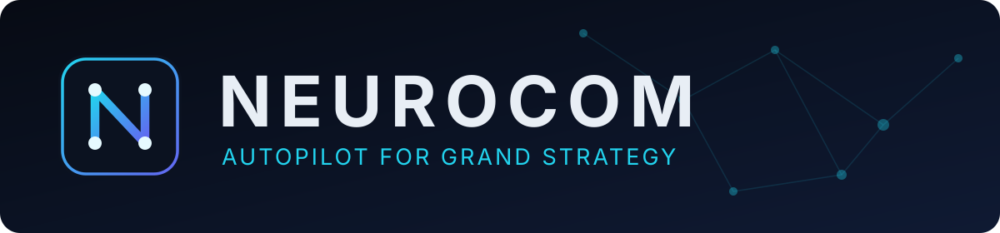
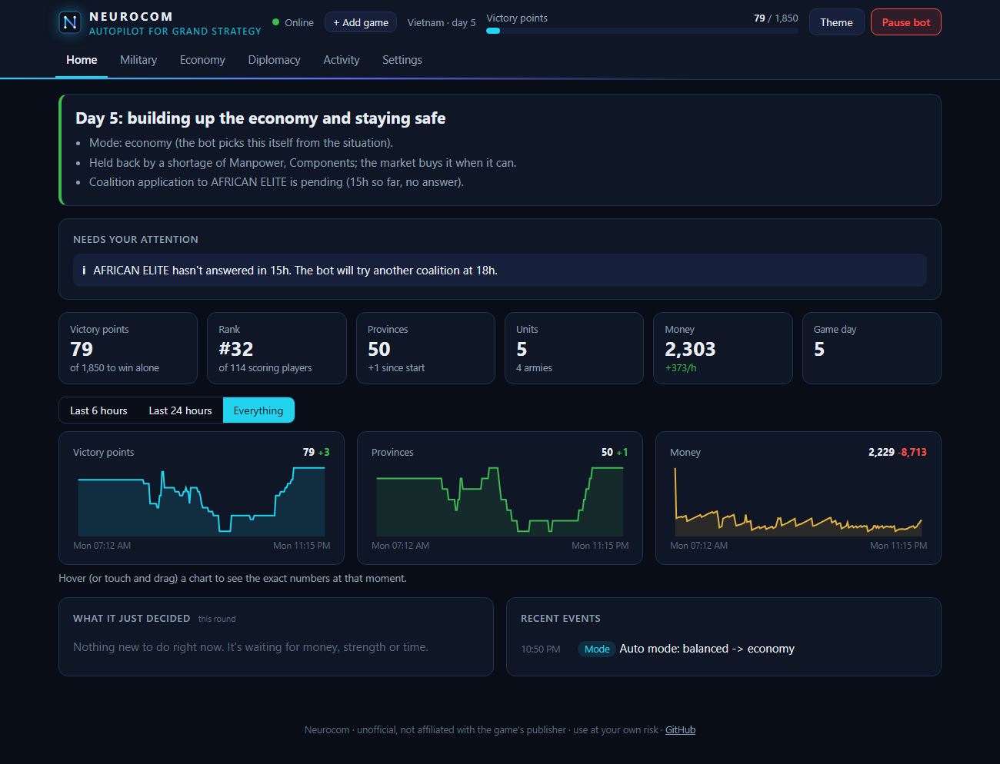
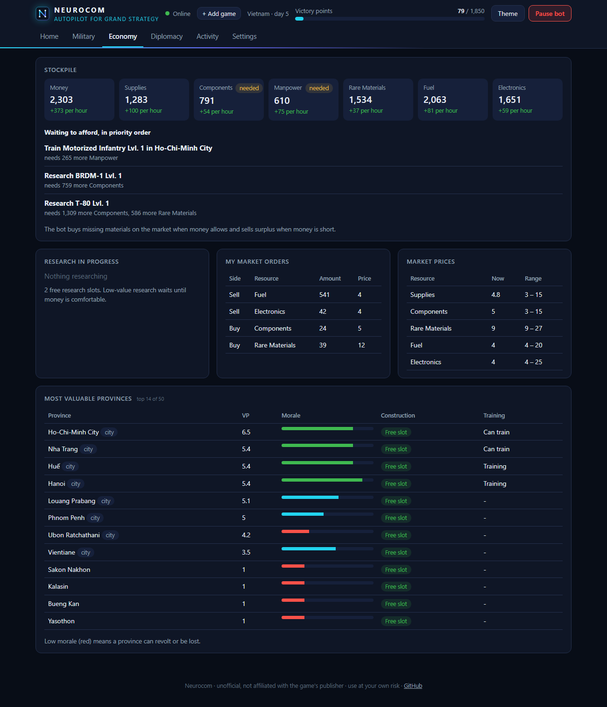
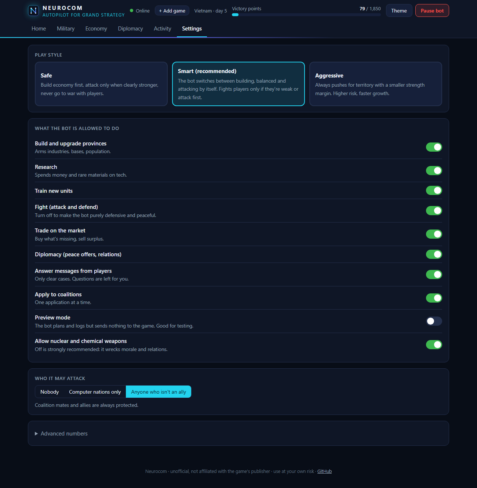
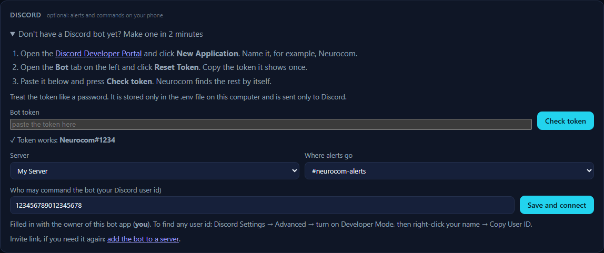

<p align="center"></p>

<p align="center">
  
  
  
  
  
</p>

# Neurocom

**An autopilot and command dashboard for the browser strategy game Conflict of Nations (WW3).** It builds, researches, trains, trades, fights, negotiates and learns, while you watch from a clean dashboard. Unofficial and not affiliated with the game or its publisher.

A browser-driven bot: Playwright keeps your logged-in game open, an in-page API issues orders through the game's own
client controllers (so requests are signed by the game itself), a strategy "brain" decides what to do, and a local
dashboard shows everything and lets you steer.

> **Read this first.** Software that plays a live game for you very likely breaks the game's Terms of Service, and accounts can be banned. Use an account you can afford to lose, and read [`DISCLAIMER.md`](DISCLAIMER.md) before you run it. It can also send in-game messages in your name.

**What it does:** builds and upgrades provinces, researches, trains units, trades on the market, attacks and defends (gathering its armies, learning from lost provinces), reads the in-game newspaper to find weak players, applies to coalitions, offers peace when it is losing, and answers simple messages in a casual voice (questions are left for you). It plays several games at once and has a dashboard (and optional Discord control).

## See it

<p align="center"></p>

<table>
  <tr>
    <td width="50%"></td>
    <td width="50%"></td>
  </tr>
</table>

<p align="center"></p>

Hover any chart for the exact numbers at that moment. Everything the bot decides is explained in plain English, and anything it will not guess at (a question from another player) is left for you.

## Quick start (Windows)

1. Install [Node.js](https://nodejs.org) once.
2. Double-click **`Start Neurocom.cmd`** (or the "Neurocom" desktop shortcut). The first run installs what it needs (a few minutes).
3. A browser window opens on the game: **log in once** (the login is remembered in `profile/`). The dashboard opens at http://127.0.0.1:8787.
4. First run only: the bot reads the game's own rules (units, buildings, research) into `data/`. That takes about a minute and is logged as "Setup".
5. **`Stop Neurocom.cmd`** stops it. Use the dashboard's **Pause bot** button to keep it connected but idle.

Optional: set the environment variable `CON_BROWSER_CHANNEL=chrome` (or `msedge`) to use the browser already installed instead of Playwright's Chromium (note: a different browser needs a fresh login).

## Discord (optional)

Set it up from the dashboard: **Settings → Discord**. You only paste the bot token.

1. Make a bot (about 2 minutes): open the [Discord Developer Portal](https://discord.com/developers/applications), click **New Application**, then on the **Bot** tab click **Reset Token** and copy it.
2. Paste the token in the Discord card and press **Check token**. Neurocom finds the bot's application id by itself, offers an **invite link** (if the bot is not in your server yet), lists your servers and channels in dropdowns, and fills in your user id (the owner of the bot app).
3. Press **Save and connect**. A message arrives in Discord within seconds. Use **Send a test message** any time.

You get alerts (province lost or captured, capital threatened, messages needing you, errors) in the channel you picked, or in your direct messages if you pick none, plus owner-only slash commands `/status`, `/report`, `/pause`, `/resume`, `/reply`, `/games`. Your token is stored only in the `.env` file on your computer (it is in `.gitignore`) and is sent only to Discord; **never share or commit it**, and reset it in the Developer Portal if it ever leaks. (Prefer files? Copy `.env.example` to `.env` and fill it in; the dashboard and the file stay in sync.)

## Playing several games

One bot process plays every game. Open a game in the bot's browser window (the **+ Add game** button on the dashboard opens another tab on the game site) and a player starts for it within about 15 seconds; close the tab and it stops. Each game has its own folder `data/games/<gameID>/` (settings, memory, history, log) and starts from neutral defaults: the bot reads the nation, day, map and players from the game itself. The dashboard has a game selector when more than one is open; Discord commands take an optional `game` (nation, player name or id) and `/games` lists them. Do **not** start a second copy of the bot: copies would fight over the dashboard port, the browser login and the Discord token.

Limits: all games are assumed to use the same rule set (unit and building tables are read once and shared), and the same game open in two tabs is played once.

## Run it from a terminal

```
npm install
npx playwright install chromium
npm start          # starts the bot + dashboard; opens the browser itself and remembers your login in ./profile
```

Dashboard: http://127.0.0.1:8787 (localhost only; mutating calls need a per-session token embedded in the page).

State is saved in `data/`: `settings.json`, `memory.json` (so restarts don't re-send messages), `activity.jsonl`
(every decision + outcome), `history.jsonl` (VP / provinces / units / money every 5 min — the raw material for tuning).

## Layout

| Path | What |
|------|------|
| `src/page/bot.js` | Injected into the game page. Reads state, and a **whitelist** of player actions: research, build, mobilize, move army, set relation, send message. No admin actions. |
| `src/bot/brain.ts` | Pure planning functions (research, construction, mobilization, attack / defence / rally, air & sea, market, coalition, diplomacy, mail). |
| `src/bot/messages.ts` | Everything the bot says to players: casual wording, never the same text to the same person twice, silence when there is nothing to say. |
| `src/bot/intel.ts`, `lab.ts`, `tuner.ts` | Learning: newspaper / activity intel per player, enemy-stack memory and per-loss lessons, air / naval return-on-capital ledger, attack-ratio and unit-cap tuning. |
| `src/bot/runner.ts` | The loop: state → plan → execute → log. Taps server responses to report accepted/refused. |
| `src/bot/settings.ts` | Defaults + validation of dashboard changes. |
| `src/dashboard/` | Local web UI (SSE live updates): Home (plain-English summary), Military, Economy, Diplomacy (coalitions, conversations, reply boxes), Activity, Settings. |
| `src/recon.ts`, `src/probe.ts`, `src/ev.ts`, `src/fgrep.ts`, `src/dumpmod.ts` | Reverse-engineering tools (traffic capture, live eval, in-page source search, rules dump to `data/`). |
| `docs/protocol.md` | What we learned about the wire protocol. |

## Commands

| Command | What |
|---------|------|
| `npm start` | Bot + dashboard (http://127.0.0.1:8787) |
| `npm test` | 54 offline scenario tests of the planners (synthetic game states) |
| `npm run typecheck` | TypeScript check |
| `npm run report` | Progress / action / refusal summary from `data/*.jsonl` |
| `npm run ev "<js>"` | Evaluate JS inside the live game page |
| `npx tsx tools/shot.ts`, `tools/gameshot.ts` | Screenshot the dashboard / the game |

Optional: set `ANTHROPIC_API_KEY` to let Claude draft replies to inbound player messages (text of those messages is then
sent to the Anthropic API; replies are text only and can never trigger actions). Without it, template replies are used.

## Safety rails

* Only a hard whitelist of ordinary player actions is callable (research, build, mobilize, move, relation, message, market order/cancel). Admin actions in the client are never used.
* Dashboard binds to localhost, mutating calls need a per-session token.
* Silent no-ops are detected (an order that changes nothing twice is blocked for 12h); server refusals are logged per action type.
* Watchdog reloads the game if its state stops updating for 12 minutes.
* Market spending is capped per order and a money floor is kept; stale bids are cancelled and re-priced.

## Strategy in one paragraph

Economy first: Arms Industry / Local Industry / Army Bases near the front, scored by value ÷ (cost × build time).
Research prioritises core units (mechanized, tanks, IFVs, AA, artillery) by priority ÷ cost, skipping WMD unless allowed.
Mobilization keeps an army mix (≈50% infantry, 25% armor, 12% artillery, 13% AA) and refuses to mobilize into a negative
economy. Military: only attacks when nearby idle armies reach `attackRatio ×` the (estimated) defence; always leaves a
garrison in valuable/recently captured cities (morale → insurgencies); only declares war on players allowed by
`warPolicy` and never on allies/coalition. Diplomacy: offers peace to neighbours/enemies it isn't attacking, replies to
inbound messages with simple intent detection, rate-limited.

## Known gaps / next steps

* No amphibious invasion, carriers, bombing or missiles; air and naval units are only used cautiously and judged by a learning ledger.
* It is weak against an active human who attacks with a bigger stack: the defences (rally, concentrated reinforcement, truce offers) help, but income, not logic, is the limit.
* City annexation (about 10,000 money plus ~15,000 in other resources) is deliberately skipped until the economy can afford it.
* Build / research weights are hand-set (with morale-aware tweaks); only attack ratio, unit cap, and the air / naval mix are learned.
* Windows only so far (restart scripts use PowerShell).

## License

[PolyForm Noncommercial License 1.0.0](LICENSE): you may use, study and modify it for noncommercial purposes; selling it or using it commercially needs separate permission. See [`NOTICE`](NOTICE) for the required notice and third-party software.

## Support and security

Questions and bugs: open a GitHub issue. Security problems: see [`SECURITY.md`](SECURITY.md). Contact: thomas.api.pc@gmail.com.
